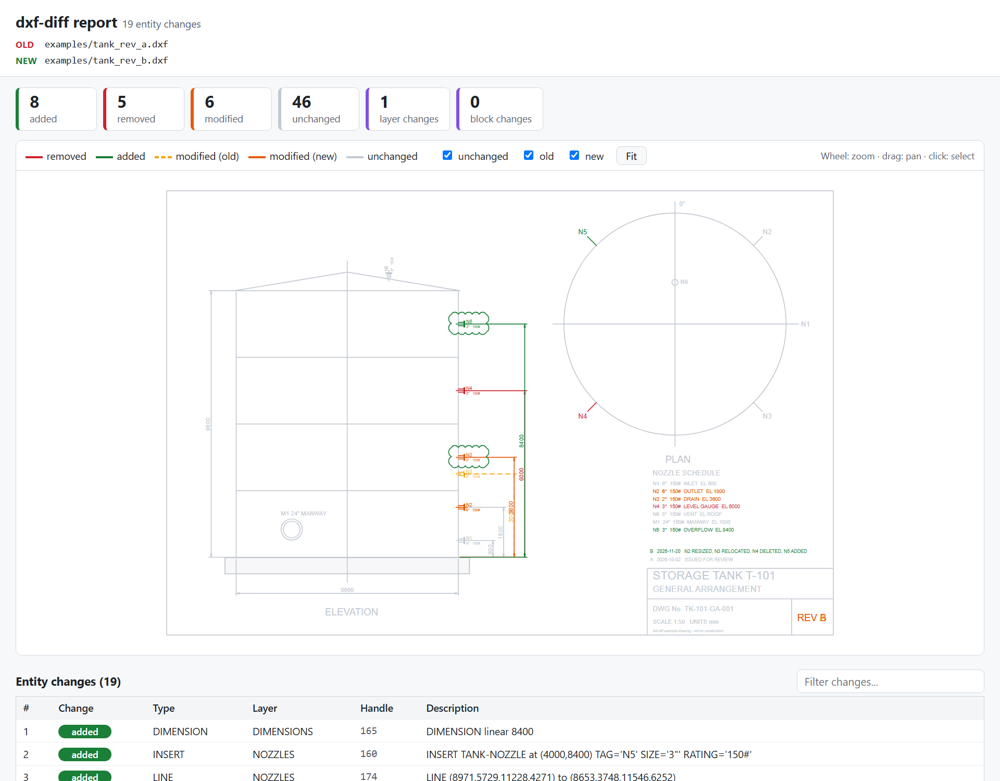

# dxf-diff: compare two DXF files and see what changed

**dxf-diff** is a free, open source Python tool to compare DXF files: a DXF diff for CAD drawing revision comparison that lists every added, removed and modified entity and draws both revisions as a colored overlay, built on [ezdxf](https://github.com/mozman/ezdxf).



*The HTML report for the example drawings in [`examples/`](examples/): nozzle N4 removed (red), N5 added (green), N3 moved and N2 resized (orange), title block REV A -> REV B.*

[](https://github.com/Shahnawaz75/dxf-diff/actions/workflows/ci.yml)
[](LICENSE)

## Why dxf-diff?

Engineers and drafters often need to know exactly what changed between two revisions of a drawing. AutoCAD's DWG Compare needs a paid AutoCAD seat, and the other comparison tools are paid plugins or viewers. dxf-diff is a small, free command line tool and Python library that:

- **compares DXF files entity by entity**: lines, polylines, circles, arcs, splines, text, block references with attributes, dimensions, hatches and more,
- **explains each change in plain words**: `LINE end moved (10,0) -> (12,0)`, `TEXT 'REV A' -> 'REV B'`, `INSERT TANK-NOZZLE attribute SIZE '4"' -> '6"'`,
- **shows the change visually**: a single, self-contained HTML file with a zoomable SVG overlay of both drawings,
- **also reports layer and block definition changes** (a layer turned off, a block redefined),
- **works in git and CI**: a `git diff` text converter for `.dxf` files, JSON output and `diff`-style exit codes,
- runs anywhere Python runs (Windows, Linux, macOS) and does not need AutoCAD.

## Install

Python 3.9 or newer:

```bash
pip install git+https://github.com/Shahnawaz75/dxf-diff
```

With PNG image output (adds matplotlib):

```bash
pip install "dxf-diff[png] @ git+https://github.com/Shahnawaz75/dxf-diff"
```

`pip install dxf-diff` is coming soon on PyPI.

## Quick start

```bash
dxf-diff old.dxf new.dxf                          # summary + list of changes
dxf-diff old.dxf new.dxf --html report.html       # visual report (add --open to open it)
dxf-diff old.dxf new.dxf --json report.json       # machine-readable diff
dxf-diff old.dxf new.dxf --png overlay.png        # static image (needs dxf-diff[png])
```

Output for the example drawings in this repository:

```text
$ dxf-diff examples/tank_rev_a.dxf examples/tank_rev_b.dxf
OLD: examples/tank_rev_a.dxf
NEW: examples/tank_rev_b.dxf
Entities: 8 added, 5 removed, 6 modified, 46 unchanged
Layers:   1 added
Blocks:   no changes

Entity changes:
  + added     DIMENSION   DIMENSIONS  165  DIMENSION linear 8400
  + added     INSERT      NOZZLES     160  INSERT TANK-NOZZLE at (4000,8400) TAG='N5' SIZE='3"' RATING='150#'
  ...
  - removed   INSERT      NOZZLES     EF   INSERT TANK-NOZZLE at (4000,6000) TAG='N4' SIZE='3"' RATING='150#'
  ...
  ~ modified  DIMENSION   DIMENSIONS  DE   DIMENSION measurement 3000 -> 3600, defpoint3 moved (4230,3000) -> (4230,3600)
  ~ modified  INSERT      NOZZLES     C3   INSERT TANK-NOZZLE attribute SIZE '4"' -> '6"'
  ~ modified  INSERT      NOZZLES     D9   INSERT TANK-NOZZLE insert moved (4000,3000) -> (4000,3600)
  ~ modified  TEXT        TITLE       13A  TEXT 'REV A' -> 'REV B'

Layer changes:
  + added     REVISION  layer added (color 6 (magenta), linetype Continuous)
```

Useful options:

| Option | Meaning |
| --- | --- |
| `-t, --tolerance 0.01` | coordinates, lengths and angles closer than this are equal (default `1e-6`) |
| `--layer PATTERN` | compare only layers matching the pattern (wildcards, repeatable) |
| `--ignore-layer PATTERN` | ignore layers, e.g. `--ignore-layer "DIM*"` |
| `--ignore-props color,linetype` | ignore display properties (`color`, `linetype`, `lineweight`, `transparency`, `layer`, ...) |
| `--layouts` | also compare paperspace layouts (default: modelspace only) |
| `--match geometry` | ignore handles, e.g. for files re-exported by another CAD program |
| `--brief`, `-q` | only the counts / no output at all |

Exit status works like `diff`: **0** no differences, **1** differences found, **2** error.

## Visual HTML report

`--html report.html` writes one HTML file with everything inlined (no external scripts, fonts or images), so you can attach it to an email, a pull request or a CI artifact.

- **SVG overlay** of both drawings: removed entities in **red**, added in **green**, modified in **orange** (old position dashed, new position solid), unchanged in light grey.
- **Pan and zoom** with mouse wheel and drag; **Fit** resets the view.
- **Table of changes**: hover a row to highlight the entity, click it to zoom to it; click an entity in the drawing to find its row. A filter box narrows the list.
- Checkboxes hide the unchanged, old or new geometry.
- Summary counts, layer table changes and block definition changes.

Curves are drawn as real SVG Bezier curves from ezdxf paths, blocks and dimensions are expanded, and unchanged geometry is merged into a few SVG paths, so drawings with tens of thousands of entities stay responsive (a 24,000-entity test drawing gives a 3 MB report that opens in about two seconds).

Prefer a static picture? `--png overlay.png` renders the same overlay with matplotlib.

## Use in git (diff .dxf files in git diff)

A DXF file is text, but its raw `git diff` is unreadable: group codes, handles and timestamps. `dxf-diff --textconv FILE` prints a **stable, sorted, normalized** text version of a drawing (no handles, no timestamps) so `git diff` shows the real edit:

```bash
# once per machine (or drop --global for one repository)
git config --global diff.dxf.textconv "dxf-diff --textconv"
# once per repository
echo "*.dxf diff=dxf" >> .gitattributes
```

```diff
-  INSERT layer="NOZZLES" name="TANK-NOZZLE" insert=(4000,1800) ... attribs={RATING="150#", SIZE="4\"", TAG="N2"}
+  INSERT layer="NOZZLES" name="TANK-NOZZLE" insert=(4000,1800) ... attribs={RATING="150#", SIZE="6\"", TAG="N2"}
```

For the full picture, use dxf-diff as a git difftool:

```bash
git config --global difftool.dxf-diff.cmd 'dxf-diff "$LOCAL" "$REMOTE" --open'
git difftool -y -t dxf-diff HEAD~1 -- drawings/plan.dxf
```

More in [docs/git-integration.md](docs/git-integration.md).

## Use in CI

The exit status makes dxf-diff easy to use in a pipeline. A GitHub Actions step that compares a drawing with the version on the main branch and keeps the visual report:

```yaml
- run: pip install git+https://github.com/Shahnawaz75/dxf-diff
- name: Compare drawing with main
  run: |
    git fetch origin main
    git show origin/main:drawings/plan.dxf > plan_main.dxf
    dxf-diff plan_main.dxf drawings/plan.dxf --html dxf-report.html --json dxf-report.json || test $? -eq 1
- uses: actions/upload-artifact@v4
  with:
    name: dxf-diff-report
    path: dxf-report.*
```

Drop `|| test $? -eq 1` to make the job fail when a drawing changed (for example to guard a released drawing).

## Python API

```python
from dxf_diff import compare

result = compare("old.dxf", "new.dxf", tolerance=1e-6)

for change in result:  # added, removed and modified entities
    print(change.kind, change.dxftype, change.layer, change.handle, change.description)

result.filter(kind="modified", dxftype="TEXT")  # filter by kind, type, layer pattern, space
result.summary()  # {'entities': {'added': 8, ...}, 'layers': {...}, ...}
result.layers, result.blocks  # layer table and block definition changes
result.to_json("report.json")  # or result.to_dict()
```

`compare()` also accepts already loaded ezdxf drawings. Each `EntityChange` keeps references to the ezdxf entities (`old_entity`, `new_entity`) and the list of changed properties. See [docs/python-api.md](docs/python-api.md).

## What is compared

| | Compared |
| --- | --- |
| LINE, POINT | end points / location |
| CIRCLE, ARC, ELLIPSE | center, radius / axes, angles or parameters |
| LWPOLYLINE, POLYLINE | vertices, bulges, closed flag, width, polyface faces |
| SPLINE | degree, control points, fit points, knots, weights |
| TEXT, MTEXT, ATTDEF | text, insert point, height, rotation, style, alignment |
| INSERT (block reference) | block name, insert point, scale, rotation, **attribute values**, MINSERT grid |
| DIMENSION | **measurement**, text override, definition points, dimension style |
| HATCH | pattern, scale, angle, solid fill, boundary paths |
| SOLID, TRACE, 3DFACE | corner points |
| every entity | layer, color, true color, linetype, linetype scale, lineweight, transparency |
| other types | all their DXF attributes (generic fallback) |
| layers | added / removed, color, linetype, lineweight, on/off, frozen, locked, plot |
| block definitions | added / removed, base point, content (compared entity by entity) |

**How entities are matched.** Within one file lineage (revision B saved from revision A) entities keep their **handles**, so dxf-diff pairs them by handle first. Entities without a partner are then paired by a **geometric fingerprint** (type + layer + rounded geometry). If the handles look unrelated, for example when another program re-exported the file, dxf-diff falls back to the fingerprint and then to **similarity** (same insert point, same block and attributes, same start point ...) to still recognise modified entities. `--match handle|geometry` forces one strategy.

## Limitations

- **DXF only.** DWG files are not read; convert them first (see the FAQ).
- The overlay shows **modelspace** in 2D (XY). Paperspace changes (`--layouts`) are listed in the table but not drawn.
- The drawing is a **preview, not a plot**: text uses a standard font instead of SHX fonts, and linetypes, lineweights and hatch patterns are not drawn (hatches are shown as lightly filled areas).
- MLEADER, ACAD_TABLE, IMAGE, proxy entities and other less common types are compared by their raw DXF attributes only, so changes stored in embedded data may be missed.
- In re-exported files (new handles) a moved entity can be reported as removed + added when there is no unique anchor to match it.
- Anonymous blocks (`*D...`, `*U...`) are not compared as block definitions. Dimensions are compared by measurement, text and definition points; dynamic block references by their properties and attributes.
- Very large drawings: beyond 60,000 drawn shapes, further unchanged entities are left out of the overlay (the report says how many).

## FAQ

### How do I compare two DXF files for free?

Install dxf-diff (`pip install git+https://github.com/Shahnawaz75/dxf-diff`) and run `dxf-diff old.dxf new.dxf --html report.html`. You get a list of every change in the terminal and a visual overlay in the browser, without AutoCAD or a paid plugin.

### How can I see what changed between two revisions of a CAD drawing?

Export or save both revisions as DXF, then run `dxf-diff rev_a.dxf rev_b.dxf --html changes.html --open`. Removed geometry is red, added geometry green and modified geometry orange; every change is listed with its layer, handle and a short description such as `INSERT VALVE attribute SIZE '4"' -> '6"'`.

### Can I diff DXF files in git?

Yes. Configure `git config diff.dxf.textconv "dxf-diff --textconv"` and add `*.dxf diff=dxf` to `.gitattributes`. `git diff`, `git log -p` and `git show` then show readable, sorted changes instead of raw DXF codes. See [docs/git-integration.md](docs/git-integration.md).

### Does it work with DWG?

No, dxf-diff does not read DWG files. Convert them to DXF first, for example with the free [ODA File Converter](https://www.opendesign.com/guestfiles/oda_file_converter) (batch conversion, command line) or by opening the DWG in LibreCAD and saving it as DXF. If you have AutoCAD or another CAD program, "Save As DXF" works too. dxf-diff tells you when you pass a DWG file by mistake.

### Do I need AutoCAD?

No. dxf-diff is pure Python on top of ezdxf and runs on Windows, Linux and macOS.

### Why does a re-exported file show no changes although every handle changed?

That is intended: entities are matched by geometry when the handles are not related, so a file saved again by another program compares equal to the original if the drawing content is the same.

## Contributing

Bug reports with a small pair of DXF files are very welcome, and so are pull requests. See [CONTRIBUTING.md](CONTRIBUTING.md) for the development setup.

## License

[MIT](LICENSE) © 2026 Shahnawaz75

If dxf-diff saved you some time, a star on GitHub helps other people find it.
