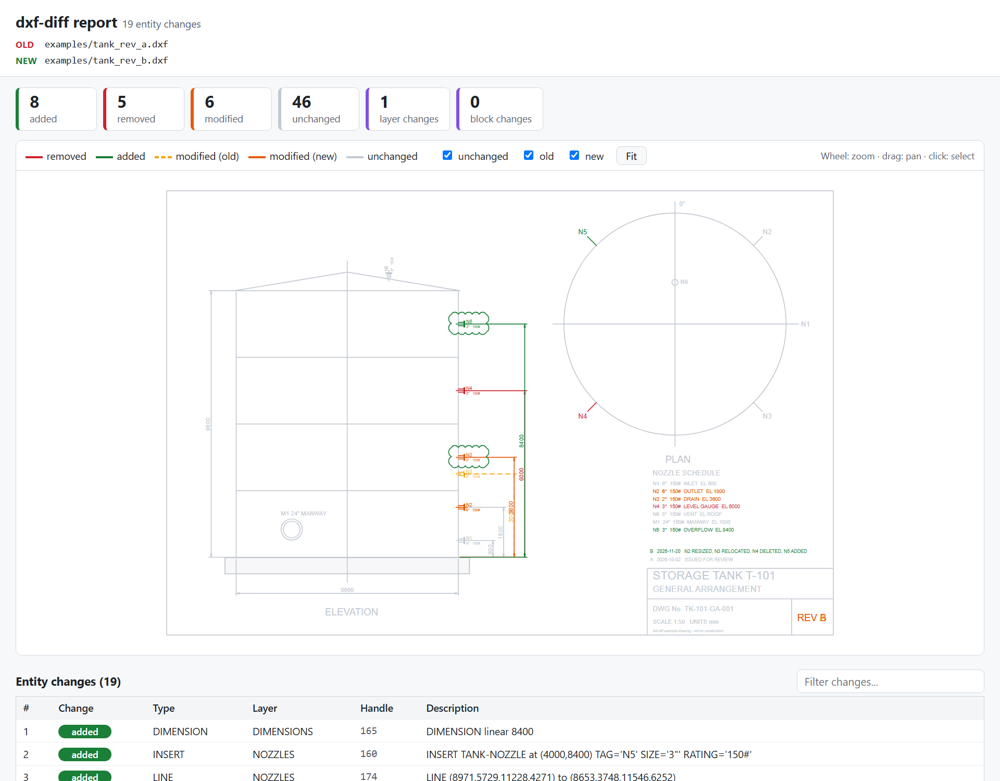

# dxf-diff

**Compare two DXF files and see what changed.** dxf-diff is a free, open source command line tool and Python library (built on [ezdxf](https://github.com/mozman/ezdxf)) for CAD drawing revision comparison. It lists every added, removed and modified entity, reports layer and block definition changes, and writes a self-contained HTML report with a zoomable overlay of both drawings.



## Features

- Entity-by-entity DXF comparison: LINE, LWPOLYLINE, POLYLINE, CIRCLE, ARC, ELLIPSE, SPLINE, TEXT, MTEXT, INSERT with attributes, DIMENSION, HATCH, POINT, SOLID, 3DFACE and a generic fallback for every other type.
- Short, readable descriptions: `LINE end moved (10,0) -> (12,0)`, `TEXT 'REV A' -> 'REV B'`, `INSERT TANK-NOZZLE attribute SIZE '4"' -> '6"'`.
- Layer table changes (color, linetype, on/off, frozen, locked ...) and block definition changes.
- Matching by handle, then by geometric fingerprint, so even re-exported files with new handles compare correctly.
- Outputs: colored terminal summary, JSON, self-contained HTML with SVG overlay, PNG image.
- Exit status like `diff` (0 same, 1 different, 2 error) for CI pipelines.
- `dxf-diff --textconv` makes `git diff` readable for `.dxf` files.

## Install

```bash
pip install git+https://github.com/Shahnawaz75/dxf-diff
```

Python 3.9 or newer. For PNG output: `pip install "dxf-diff[png] @ git+https://github.com/Shahnawaz75/dxf-diff"`. A PyPI release (`pip install dxf-diff`) is coming soon.

## Quick start

```bash
dxf-diff old.dxf new.dxf                     # what changed, in the terminal
dxf-diff old.dxf new.dxf --html report.html  # visual report with SVG overlay
dxf-diff old.dxf new.dxf --json report.json  # machine-readable diff
```

```python
from dxf_diff import compare

for change in compare("old.dxf", "new.dxf"):
    print(change.kind, change.dxftype, change.layer, change.description)
```

## Documentation

- [Use dxf-diff with git](git-integration.md): `git diff` for `.dxf` files, difftool, CI
- [Python API](python-api.md): `compare()`, result objects, JSON format
- [README on GitHub](https://github.com/Shahnawaz75/dxf-diff#readme): options, what is compared, limitations, FAQ

dxf-diff does not read DWG files; convert DWG to DXF first, for example with the free ODA File Converter.

Source code and issues: [github.com/Shahnawaz75/dxf-diff](https://github.com/Shahnawaz75/dxf-diff) (MIT license).
